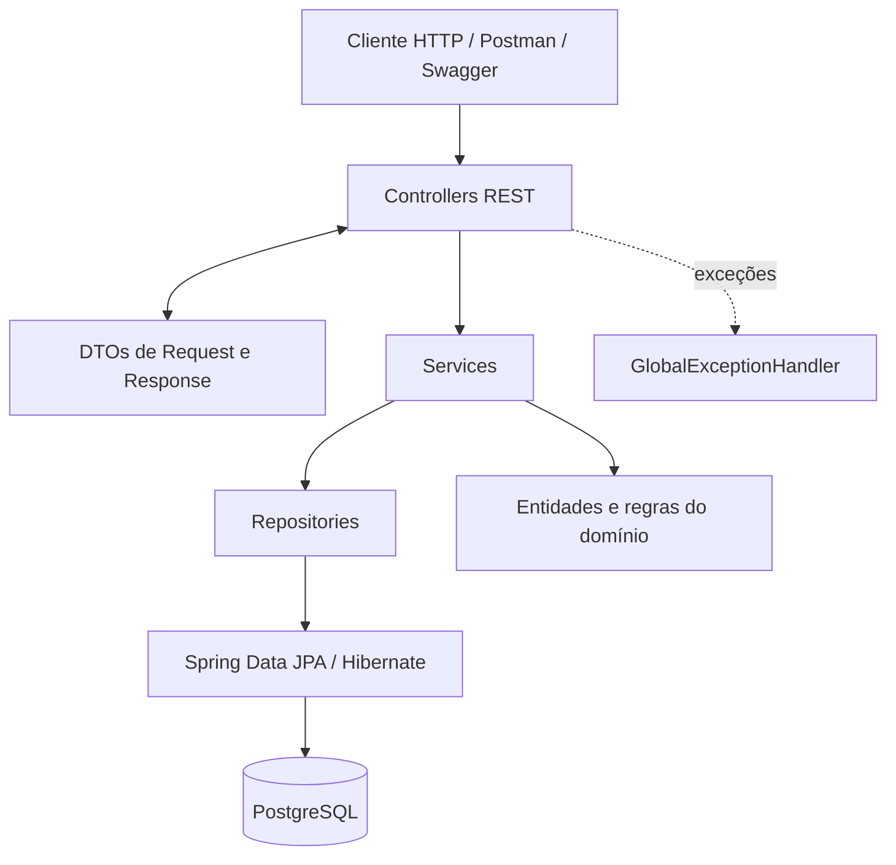
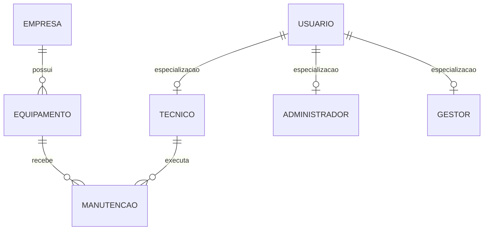
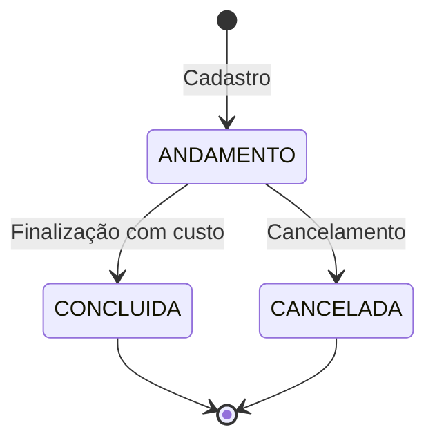
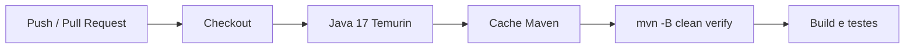

# 🔧 Maintenance Management System

**API REST para gerenciamento de empresas, equipamentos, usuários e manutenções industriais**, desenvolvida com Java 17, Spring Boot, Spring Data JPA e PostgreSQL.


> **Status do projeto:** API funcional, com CRUDs, regras de negócio, testes unitários, geração de relatório de cobertura, documentação OpenAPI, pipeline de CI, análise estática local e execução com Docker Compose. Projeto de estudo e portfólio, em evolução.

## 📑 Sumário

- [Sobre o projeto](#-sobre-o-projeto)
- [Como executar com Docker](#-como-executar-com-docker)
- [Tecnologias](#-tecnologias)
- [Arquitetura](#-arquitetura)
- [Modelo de domínio](#-modelo-de-domínio)
- [Funcionalidades e regras de negócio](#-funcionalidades-e-regras-de-negócio)
- [Endpoints da API](#-endpoints-da-api)
- [Exemplos de requisições](#-exemplos-de-requisições)
- [Swagger / OpenAPI](#-swagger--openapi)
- [Testes e cobertura](#-testes-e-cobertura)
- [Integração contínua](#-integração-contínua)
- [Análise estática com SonarQube](#-análise-estática-com-sonarqube)
- [Execução local sem Docker](#-execução-local-sem-docker)
- [Configuração e boas práticas](#-configuração-e-boas-práticas)
- [Evolução e próximos passos](#-evolução-e-próximos-passos)
- [Autor](#-autor)

---

## 🎯 Sobre o projeto

O **Maintenance Management System** simula o gerenciamento do ciclo de vida de equipamentos e manutenções em empresas: cadastro, associação de responsáveis, abertura de serviços, acompanhamento de status, encerramento e controle de regras de integridade.

O projeto começou com **Java, JDBC e MySQL**, com consultas SQL, DAOs e transações controladas manualmente. Em sua segunda versão, foi transformado em uma **API REST com Spring Boot e PostgreSQL**, permitindo explorar a diferença entre implementar a persistência diretamente e utilizar as abstrações do Spring e do Hibernate.

Mais do que operações de CRUD, o foco está em aspectos relevantes do desenvolvimento Back-End:

- **Modelagem de domínio:** entidades, herança, relacionamentos e estados válidos.
- **Integridade de dados:** unicidade, validações e exclusões condicionadas a vínculos.
- **Organização do código:** controllers, services, repositories e DTOs separados.
- **Persistência:** JPA/Hibernate, transações e carregamento planejado de relacionamentos.
- **Confiabilidade:** testes unitários, tratamento global de erros e integração contínua.
- **Execução e manutenção:** Swagger/OpenAPI, Docker Compose, JaCoCo e SonarQube.

### Evolução técnica

| Aspecto | Primeira versão | Versão atual |
| --- | --- | --- |
| Interface | Aplicação de console | API REST com JSON/HTTP |
| Persistência | JDBC e DAOs | Spring Data JPA / Hibernate |
| Banco de dados | MySQL | PostgreSQL |
| Transações | Controle manual | `@Transactional` |
| Validação | Regras em Java | Bean Validation + domínio |
| Tratamento de erros | Exceções da aplicação | Respostas HTTP com `@RestControllerAdvice` |
| Testes | Testes do projeto original | Testes unitários com JUnit 5 e Mockito |
| Documentação | — | Swagger / OpenAPI |
| Automação e execução | Execução manual | GitHub Actions + Docker Compose |

---

## 🐳 Como executar com Docker

Esta é a **forma mais simples de iniciar o projeto**. O Docker Compose configura a aplicação Spring Boot e o PostgreSQL sem exigir uma instalação local desses componentes.

**Pré-requisitos:** Docker Engine / Docker Desktop com o plugin Docker Compose e portas **8080** e **5433** disponíveis.

### 1. Baixe o projeto

Clone o repositório pelo GitHub ou baixe o ZIP e abra o terminal na pasta que contém `compose.yaml`.

### 2. Inicie os serviços

```bash
docker compose up --build -d
```

O Compose:

1. baixa a imagem do PostgreSQL 18;
2. constrói a imagem da aplicação em duas etapas, com Maven + Java 17 para build e Java 17 JRE para execução;
3. cria um volume persistente para o banco de dados;
4. aguarda o healthcheck do PostgreSQL antes de iniciar a aplicação;
5. publica a API em `http://localhost:8080`.

### 3. Acesse a API

| Serviço | Endereço |
| --- | --- |
| API REST | `http://localhost:8080/api` |
| Swagger UI | [`http://localhost:8080/swagger-ui/index.html`](http://localhost:8080/swagger-ui/index.html) |
| Especificação OpenAPI | [`http://localhost:8080/v3/api-docs`](http://localhost:8080/v3/api-docs) |
| PostgreSQL, a partir do computador | `localhost:5433` |

> O PostgreSQL escuta na porta **5432 dentro da rede Docker**. A aplicação usa o endereço `db:5432`, enquanto clientes executados no computador usam `localhost:5433`.

### 4. Comandos úteis

```bash
# Verificar os containers
docker compose ps

# Acompanhar os logs da aplicação
docker compose logs -f app

# Parar e remover os containers sem excluir o volume do banco
docker compose down

# Reiniciar os serviços
docker compose up -d

# ATENÇÃO: remover containers e apagar os dados persistidos
docker compose down -v
```

**Nota:** a configuração atual do `compose.yaml` usa credenciais de desenvolvimento (`postgres` / `root`) e destina-se a **ambiente local**, não à produção. Não reutilize essas credenciais em uma implantação pública.

---

## 🛠️ Tecnologias

| Categoria | Tecnologias / finalidade |
| --- | --- |
| Linguagem e framework | Java 17, Spring Boot 3.5.16, Spring Web |
| Persistência | Spring Data JPA, Hibernate, PostgreSQL |
| Modelagem e validação | Jakarta Bean Validation, Lombok, DTOs com `record` |
| Testes | JUnit 5, Mockito, Spring Boot Starter Test |
| Cobertura | JaCoCo |
| API | REST, JSON, SpringDoc OpenAPI / Swagger UI |
| Build | Maven |
| Automação | GitHub Actions |
| Qualidade | SonarQube (análise local) |
| Containers | Docker, Docker Compose, Dockerfile multi-stage |
| Desenvolvimento | Git, GitHub, IntelliJ IDEA, Postman |

---

## 🏗️ Arquitetura

A aplicação adota uma arquitetura em camadas, separando o contrato HTTP, a execução das regras de negócio e a persistência.



### Responsabilidades

| Pacote | Papel |
| --- | --- |
| `controller` | Mapeamento de endpoints, validação de entrada e respostas HTTP |
| `dto` | Contratos de entrada e saída, sem expor entidades JPA diretamente |
| `service` | Casos de uso, coordenação das regras e limites transacionais |
| `model` | Entidades, relacionamentos e regras próprias do domínio |
| `repository` | Consultas e persistência com Spring Data JPA |
| `exceptions` | Exceções específicas da aplicação |
| `handler` | Conversão de exceções para respostas HTTP padronizadas |
| `config` | Configuração da documentação OpenAPI |

### Estrutura de pastas

```text
maintenance-management-system/
├── .github/
│   └── workflows/
│       └── ci.yml
├── Dockerfile
├── compose.yaml
├── .dockerignore
├── pom.xml
├── src/
│   ├── main/
│   │   ├── java/com/joao/empresa/
│   │   │   ├── config/          # OpenApiConfig
│   │   │   ├── controller/      # Endpoints REST
│   │   │   ├── dto/             # Requests, responses e erros
│   │   │   ├── exceptions/      # Exceções de negócio
│   │   │   ├── handler/         # GlobalExceptionHandler
│   │   │   ├── model/           # Entidades e domínio
│   │   │   ├── repository/      # Repositórios JPA
│   │   │   ├── service/         # Regras e casos de uso
│   │   │   └── MaintenanceManagementApplication.java
│   │   └── resources/
│   │       └── application.properties
│   └── test/java/com/joao/empresa/
│       ├── builders/            # Dados de apoio aos testes
│       └── service/             # Testes unitários dos services
└── README.md
```

### Persistência: LAZY, EntityGraph e transações

Os relacionamentos `@ManyToOne` de **equipamento → empresa** e **manutenção → equipamento / técnico** são configurados com `FetchType.LAZY`. Para carregar os relacionamentos necessários nas consultas que montam DTOs, os repositories aplicam **`@EntityGraph`** em métodos específicos.

O projeto também configura:

```properties
spring.jpa.open-in-view=false
```

Com isso, a aplicação evita depender de uma sessão de persistência aberta durante toda a requisição. Os services usam `@Transactional(readOnly = true)` por padrão e `@Transactional` nas operações de escrita. A combinação busca tornar explícitos os limites transacionais e os dados necessários para cada operação.

---

## 🧩 Modelo de domínio



- **Empresa:** nome, CNPJ, endereço, segmento e status (`ATIVADA` ou `DESATIVADA`).
- **Equipamento:** nome, código de patrimônio, data de aquisição e empresa vinculada.
- **Usuário:** entidade abstrata com nome, e-mail e tipo. Possui especializações `Administrador` (departamento), `Gestor` (área responsável) e `Tecnico` (especialidade), persistidas por herança JPA `JOINED`.
- **Manutenção:** tipo (`PREVENTIVA` ou `CORRETIVA`), descrição, datas, custo, status, equipamento e técnico responsável.

### Ciclo de vida da manutenção



Toda manutenção é criada com `status = ANDAMENTO`, `custo = 0,00` e `dataFim = null`. A data de encerramento é definida pela aplicação ao finalizar ou cancelar. Manutenções concluídas ou canceladas não podem ser editadas ou reabertas pelos métodos existentes.

---

## ✨ Funcionalidades e regras de negócio

### Empresas

- Cadastro, consulta, listagem, atualização e exclusão.
- Controle de status `ATIVADA` / `DESATIVADA`.
- CNPJ único, verificado na aplicação e por restrição no banco.
- Exclusão impedida quando existem equipamentos vinculados.

### Equipamentos

- Cadastro, consulta, listagem, atualização e exclusão.
- Associação obrigatória a uma empresa existente.
- Código de patrimônio único.
- Exclusão impedida quando existem manutenções vinculadas.
- A atualização de dados não altera a empresa associada.

### Usuários

- Cadastro específico de administradores, gestores e técnicos.
- Consulta, listagem geral, atualização por tipo e exclusão.
- Unicidade de e-mail.
- Validação de tipo concreto nas operações de atualização.
- Exclusão de técnicos impedida quando possuem manutenções associadas.

### Manutenções

- Abertura de manutenções preventivas ou corretivas.
- Associação obrigatória a equipamento e usuário do tipo técnico.
- Busca por ID e listagem geral, por status, equipamento ou técnico.
- Atualização permitida somente enquanto `ANDAMENTO`.
- Finalização com custo não negativo e registro da data de término.
- Cancelamento com registro da data de término.
- Exclusão permitida somente para manutenções encerradas.
- Validação para impedir data final anterior à inicial.

### Validações e tratamento de erros

A entrada é validada com anotações como `@NotBlank`, `@NotNull`, `@Email`, `@Size`, `@Positive` e `@PositiveOrZero`. Regras adicionais são aplicadas na camada de serviço e nas entidades.

O `GlobalExceptionHandler`, implementado com `@RestControllerAdvice`, padroniza respostas de erro:

| Código | Quando é usado |
| --- | --- |
| `400 Bad Request` | Entrada inválida ou argumento inconsistente |
| `404 Not Found` | Recurso não encontrado |
| `409 Conflict` | Duplicidade, recurso em uso ou transição de estado proibida |
| `500 Internal Server Error` | Erro não tratado especificamente |

Exemplo de resposta de erro:

```json
{
  "timestamp": "2026-11-10T10:00:00",
  "status": 404,
  "error": "Not Found",
  "message": "Empresa com ID 999 não encontrada.",
  "path": "/api/empresas/999"
}
```

---

## 🌐 Endpoints da API

**Base URL:** `http://localhost:8080/api`

### Empresas

| Método | Rota | Ação |
| --- | --- | --- |
| `GET` | `/empresas` | Listar |
| `GET` | `/empresas/{id}` | Consultar por ID |
| `POST` | `/empresas` | Cadastrar |
| `PUT` | `/empresas/{id}` | Atualizar |
| `DELETE` | `/empresas/{id}` | Excluir |

### Equipamentos

| Método | Rota | Ação |
| --- | --- | --- |
| `GET` | `/equipamentos` | Listar |
| `GET` | `/equipamentos/{id}` | Consultar por ID |
| `POST` | `/equipamentos` | Cadastrar |
| `PUT` | `/equipamentos/{id}` | Atualizar |
| `DELETE` | `/equipamentos/{id}` | Excluir |

### Usuários

| Método | Rota | Ação |
| --- | --- | --- |
| `GET` | `/usuarios` | Listar todos os tipos |
| `GET` | `/usuarios/{id}` | Consultar por ID |
| `POST` | `/usuarios/administradores` | Cadastrar administrador |
| `POST` | `/usuarios/gestores` | Cadastrar gestor |
| `POST` | `/usuarios/tecnicos` | Cadastrar técnico |
| `PUT` | `/usuarios/administradores/{id}` | Atualizar administrador |
| `PUT` | `/usuarios/gestores/{id}` | Atualizar gestor |
| `PUT` | `/usuarios/tecnicos/{id}` | Atualizar técnico |
| `DELETE` | `/usuarios/{id}` | Excluir usuário |

### Manutenções

| Método | Rota | Ação |
| --- | --- | --- |
| `GET` | `/manutencoes` | Listar todas |
| `GET` | `/manutencoes/{id}` | Consultar por ID |
| `GET` | `/manutencoes/ativas` | Listar em andamento |
| `GET` | `/manutencoes/concluidas` | Listar concluídas |
| `GET` | `/manutencoes/canceladas` | Listar canceladas |
| `GET` | `/manutencoes/equipamento/{equipamentoId}` | Filtrar por equipamento |
| `GET` | `/manutencoes/tecnico/{tecnicoId}` | Filtrar por técnico |
| `POST` | `/manutencoes` | Cadastrar |
| `PUT` | `/manutencoes/{id}` | Atualizar em andamento |
| `PATCH` | `/manutencoes/{id}/finalizar` | Finalizar |
| `PATCH` | `/manutencoes/{id}/cancelar` | Cancelar |
| `DELETE` | `/manutencoes/{id}` | Excluir encerrada |

Os endpoints de criação utilizam `201 Created`; as exclusões bem-sucedidas retornam `204 No Content`. As respostas de consulta e atualização utilizam `200 OK`.

---

## 📮 Exemplos de requisições

Envie `Content-Type: application/json` nos requests que possuem corpo. Os exemplos abaixo podem ser executados pelo Postman ou Swagger UI.

**1. Cadastrar empresa — `POST /api/empresas`**

```json
{
  "nome": "Indústria Alfa",
  "cnpj": "12.345.678/0001-90",
  "endereco": "Rua das Indústrias, 100",
  "segmento": "Metalurgia",
  "status": "ATIVADA"
}
```

**2. Cadastrar técnico — `POST /api/usuarios/tecnicos`**

```json
{
  "nome": "Carlos Silva",
  "email": "carlos@exemplo.com",
  "especialidade": "Elétrica"
}
```

**3. Cadastrar equipamento — `POST /api/equipamentos`**

```json
{
  "nome": "Torno CNC",
  "codigoPatrimonio": "PAT-001",
  "dataAquisicao": "2026-01-15",
  "empresaId": 1
}
```

**4. Abrir manutenção — `POST /api/manutencoes`**

```json
{
  "tipoManutencao": "PREVENTIVA",
  "descricao": "Inspeção e lubrificação do equipamento",
  "dataInicio": "2026-11-10",
  "equipamentoId": 1,
  "tecnicoId": 1
}
```

Exemplo ilustrativo de resposta (considerando que os IDs informados existem):

```json
{
  "id": 1,
  "tipoManutencao": "PREVENTIVA",
  "descricao": "Inspeção e lubrificação do equipamento",
  "dataInicio": "2026-11-10",
  "dataFim": null,
  "custo": 0.00,
  "status": "ANDAMENTO",
  "equipamentoId": 1,
  "equipamentoNome": "Torno CNC",
  "tecnicoId": 1,
  "tecnicoNome": "Carlos Silva"
}
```

**5. Finalizar manutenção — `PATCH /api/manutencoes/1/finalizar`**

```json
{
  "custo": 350.00
}
```

**6. Cancelar manutenção — `PATCH /api/manutencoes/1/cancelar`**

Esta requisição não exige corpo. A manutenção precisa estar em andamento.

> **Ordem recomendada para testes manuais:** cadastrar empresa → cadastrar técnico → cadastrar equipamento vinculado à empresa → abrir manutenção → finalizar ou cancelar.

---

## 📖 Swagger / OpenAPI

O projeto integra **SpringDoc OpenAPI** e oferece documentação interativa dos endpoints. Os controllers utilizam as anotações `@Tag` e `@Operation`, enquanto `OpenApiConfig` define título, descrição e versão do documento.

Com a aplicação em execução:

- **Swagger UI:** [`http://localhost:8080/swagger-ui/index.html`](http://localhost:8080/swagger-ui/index.html)
- **Documento OpenAPI JSON:** [`http://localhost:8080/v3/api-docs`](http://localhost:8080/v3/api-docs)

A interface permite inspecionar requests, responses e executar chamadas de teste diretamente pelo navegador.

---

## 🧪 Testes e cobertura

A suíte implementada contém **42 métodos de teste unitário** nos services, com **JUnit 5 e Mockito**, utilizando mocks para isolar repositories e builders para preparar cenários de teste.

| Classe de teste | Métodos de teste |
| --- | ---: |
| `EmpresaServiceTest` | 7 |
| `EquipamentoServiceTest` | 8 |
| `UsuarioServiceTest` | 13 |
| `ManutencaoServiceTest` | 14 |
| **Total** | **42** |

Os cenários cobrem, entre outros: consultas e cadastros, validação de unicidade, entidades inexistentes, vínculos obrigatórios, atualização, exclusão condicionada e transições de manutenção.

### Rodar testes

```bash
mvn test
```

### Compilar, testar e executar a verificação do Maven

```bash
mvn clean verify
```

O **JaCoCo** está configurado no `pom.xml` para instrumentar os testes e gerar um relatório HTML de cobertura durante o ciclo de build. Após a execução, abra:

```text
target/site/jacoco/index.html
```

> A quantidade de testes acima foi conferida nos arquivos-fonte. Um percentual de cobertura ou resultado de execução não é afirmado aqui, pois deve ser obtido pelo relatório/execução no ambiente correspondente. Testes de integração ainda não fazem parte da suíte apresentada.

---

## 🔄 Integração contínua

O workflow `.github/workflows/ci.yml` utiliza **GitHub Actions** para executar verificações automáticas em eventos de `push` e `pull_request`.



O comando principal do pipeline é:

```bash
mvn -B clean verify
```

Assim, alterações enviadas ao GitHub passam por compilação e testes automatizados. O resultado de cada execução pode ser consultado na aba **Actions** e nos checks do Pull Request.

**Importante:** o pipeline atual **não** publica automaticamente o relatório JaCoCo nem executa uma análise do SonarQube. Essas integrações podem ser adicionadas posteriormente.

---

## 🔎 Análise estática com SonarQube

O SonarQube é utilizado **localmente**, com análise acionada pelo Maven, para inspecionar indicadores de qualidade e identificar possíveis problemas de manutenção, bugs e vulnerabilidades.

Com o servidor SonarQube já iniciado em `http://localhost:9000`, é possível executar a análise pelo PowerShell:

```powershell
# Solicita o token sem exibi-lo na digitação
$tokenSeguro = Read-Host "Token do SonarQube" -AsSecureString
$env:SONAR_TOKEN = [System.Net.NetworkCredential]::new("", $tokenSeguro).Password
$env:SONAR_HOST_URL = "http://localhost:9000"

# Executa build, testes e análise
mvn clean verify org.sonarsource.scanner.maven:sonar-maven-plugin:sonar "-Dsonar.projectKey=maintenance-management-system"

# Remove o token do ambiente ao terminar
Remove-Item Env:\SONAR_TOKEN
```

Os resultados ficam disponíveis no painel do projeto no SonarQube local. **O scanner não integra o GitHub Actions nesta versão.**

---

## 💻 Execução local sem Docker

Caso prefira executar no IntelliJ IDEA ou pelo terminal:

**Pré-requisitos:** Java 17, Maven e PostgreSQL acessível na porta configurada.

**1. Crie o banco:**

```sql
CREATE DATABASE manutencao_db;
```

**2. Configure as variáveis do banco:**

O arquivo `application.properties` aceita as seguintes variáveis de ambiente:

| Variável | Padrão no projeto | Finalidade |
| --- | --- | --- |
| `DB_URL` | `jdbc:postgresql://localhost:5432/manutencao_db` | URL JDBC |
| `DB_USERNAME` | `postgres` | Usuário |
| `DB_PASSWORD` | `root` | Senha local |

Exemplo no PowerShell, substituindo pelos dados da sua instalação:

```powershell
$env:DB_URL = "jdbc:postgresql://localhost:5432/manutencao_db"
$env:DB_USERNAME = "postgres"
$env:DB_PASSWORD = "SUA_SENHA_LOCAL"
```

**3. Inicie a aplicação:**

```bash
mvn spring-boot:run
```

Também é possível iniciar a classe `MaintenanceManagementApplication` pela IDE.

> **Atenção às portas:** se estiver executando **apenas o banco via Docker Compose**, mas a aplicação no IntelliJ, use `jdbc:postgresql://localhost:5433/manutencao_db`. A porta `5432` é o padrão do PostgreSQL instalado diretamente no computador; `5433` é a porta publicada pelo Compose atual.

---

## ⚙️ Configuração e boas práticas

Algumas escolhas técnicas importantes no projeto:

- **DTOs com Java Records:** contratos de entrada e saída independentes das entidades JPA.
- **`@Valid` e Bean Validation:** validação de requests na fronteira HTTP.
- **`@Transactional`:** operações de leitura e escrita com limites transacionais definidos nos services.
- **`FetchType.LAZY` + `@EntityGraph`:** controle explícito do carregamento de relacionamentos nas consultas que precisam deles.
- **`spring.jpa.open-in-view=false`:** evita depender de Open Session in View para montar respostas.
- **Herança `JOINED`:** persistência de administradores, gestores e técnicos com dados compartilhados.
- **Restrições de unicidade:** apoio do banco para CNPJ, patrimônio e e-mail.
- **Docker multi-stage:** Maven usado para gerar o JAR; imagem final utiliza apenas o runtime Java.
- **Persistência em volume Docker:** os dados permanecem entre recriações de containers, a menos que o volume seja removido.

### Limitações atuais

Este repositório é um projeto de estudos, **não uma configuração pronta para produção**:

- **Não há autenticação ou autorização implementadas** nesta versão; Spring Security ainda é um próximo passo.
- O Compose define credenciais fixas de banco **somente para desenvolvimento local**.
- `spring.jpa.hibernate.ddl-auto=update` simplifica os estudos, mas um ambiente produtivo deve considerar migrações versionadas de banco.
- O Dockerfile utiliza `-DskipTests` na etapa de empacotamento; a execução dos testes ocorre separadamente no GitHub Actions via `mvn clean verify`.
- A análise SonarQube é local, sem publicação automática de resultados no CI.

---

## 🗺️ Evolução e próximos passos

### Implementado

- [x] Primeira versão com Java, JDBC e MySQL
- [x] Migração para Java 17, Spring Boot e PostgreSQL
- [x] CRUD de empresas, equipamentos, usuários e manutenções
- [x] Modelagem de domínio e herança JPA
- [x] Spring Data JPA / Hibernate
- [x] Regras de negócio, integridade e Bean Validation
- [x] DTOs, respostas HTTP e tratamento global de exceções
- [x] Gerenciamento de transações
- [x] `FetchType.LAZY`, `@EntityGraph` e Open Session in View desabilitado
- [x] 42 métodos de testes unitários com JUnit 5 e Mockito
- [x] Geração de relatório de cobertura com JaCoCo
- [x] Documentação interativa com Swagger / OpenAPI
- [x] Pipeline de CI com GitHub Actions
- [x] Análise estática local com SonarQube
- [x] Dockerfile multi-stage e Docker Compose com PostgreSQL

### Planejado / possíveis melhorias

- [ ] Adicionar autenticação e autorização com Spring Security
- [ ] Adicionar testes de integração (API + banco)
- [ ] Integrar SonarQube e relatórios de cobertura ao pipeline
- [ ] Substituir credenciais fixas por configuração segura de ambiente
- [ ] Adotar migrações versionadas de banco (ex.: Flyway)
- [ ] Preparar configuração de deploy em ambiente externo

---

## 👨‍💻 Autor

Desenvolvido por **João Emanuel** como projeto de estudo e portfólio na área de **Desenvolvimento Back-End Java**, com foco em API REST, modelagem de domínio, persistência, testes, qualidade e infraestrutura.

> O objetivo deste repositório é documentar não apenas a implementação da aplicação, mas também sua evolução técnica: **de JDBC e SQL manual para uma API Spring Boot com testes, automação e execução em containers**.
